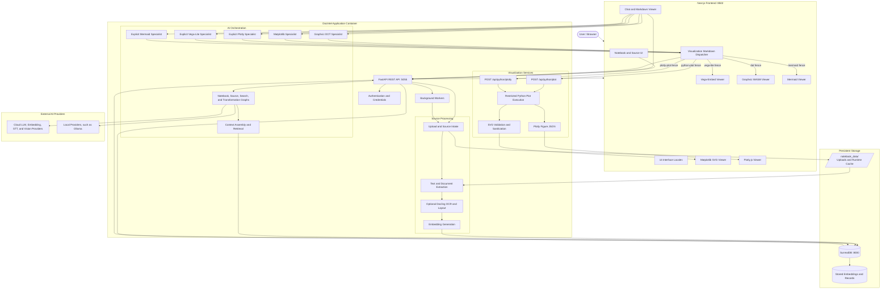
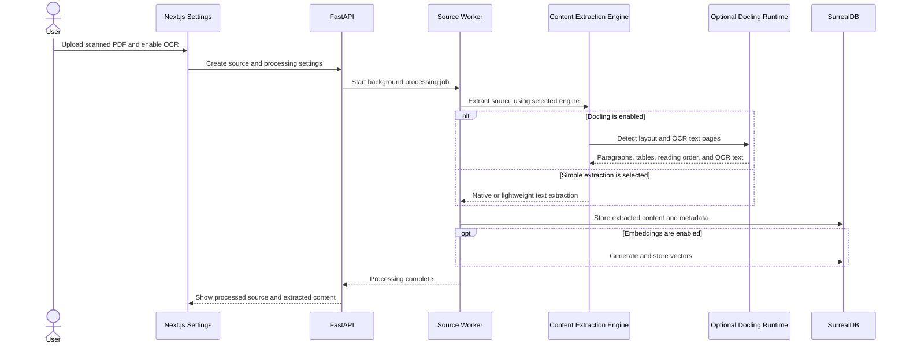
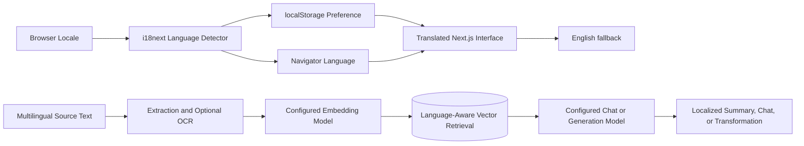

# DocIntel Architecture

This document describes DocIntel's runtime, processing, AI, storage, and visualization flows.

## Runtime flow

1. The browser uses the Next.js interface to create notebooks, upload sources, manage settings, and chat.
2. FastAPI validates requests and routes them to application endpoints or background workers.
3. Source processing extracts text, tables, and document structure from PDF, DOCX, XLSX, URLs, text, and supported media.
4. Optional Docling processing adds layout analysis and OCR for scanned PDFs and images.
5. A configured embedding model converts extracted text into vectors for semantic search and retrieval. Embeddings are persisted in SurrealDB.
6. AI graphs combine retrieved context with a configured language, embedding, and chat model before returning streamed responses.
7. Visualization format policy selects Matplotlib for default data charts and Graphviz DOT for default relationship, workflow, and architecture diagrams. Plotly, Vega-Lite, and Mermaid are generated when explicitly requested or selected from regeneration.
8. The Markdown dispatcher sends Matplotlib and Plotly Python blocks to separate FastAPI endpoints. Matplotlib returns SVG; Plotly returns figure JSON for browser-side Plotly.js rendering. Vega-Lite, DOT, and Mermaid render locally with Vega-Embed, Graphviz WASM, and Mermaid respectively.
9. Local files and runtime state remain under `notebook_data/`; SurrealDB records remain under `surreal_data/`.

## Visualization formats

| Format | Default or selection | Render path |
| --- | --- | --- |
| Matplotlib/Python | Default for data charts | Python execution through `/api/python/plot`; backend returns SVG for the frontend |
| Graphviz DOT | Default for relationships, workflows, and architecture diagrams | Browser-side Graphviz WASM renderer |
| Plotly/Python | Explicit request or regeneration | Python execution through `/api/python/plotly`; backend returns figure JSON for Plotly.js |
| Vega-Lite | Explicit request or regeneration | Browser-side `vega-embed` compilation and rendering |
| Mermaid | Explicit request or regeneration | Browser-side Mermaid rendering |

Generated visualizations are returned as fenced Markdown blocks. The frontend dispatches each recognized fence to its format-specific renderer and exposes format-appropriate source and image export controls. Regeneration sends the selected target format back through chat.

## OCR flow

## Multilingual flow

## Security boundaries

- Provider credentials are encrypted by the application using the configured encryption key.
- `.env`, uploads, databases, credentials, caches, and runtime data must not be committed.
- Mermaid uses strict rendering mode and generated SVG output is sanitized before browser insertion.
- Python chart requests use AST checks, import restrictions, code/output limits, a timeout, and temporary working directories. Plotly figure data is serialized to JSON and rendered by the local Plotly.js package.
- Python chart execution uses process-level restrictions and is not a fully isolated sandbox for arbitrary untrusted code.

For setup and operational instructions, see [README.md](README.md).
