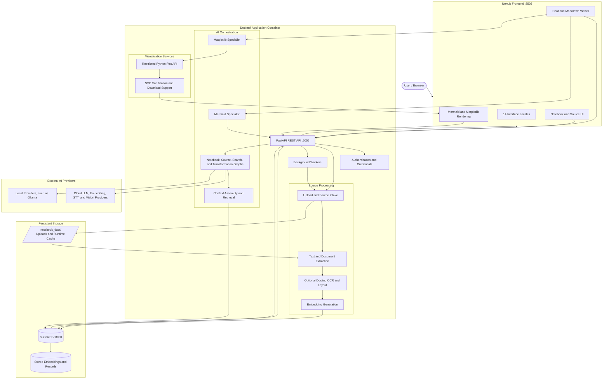
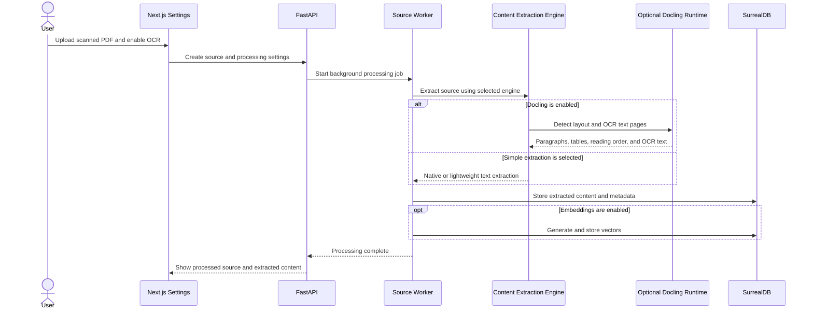
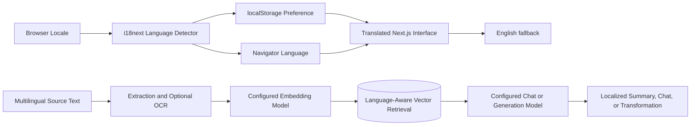

# DocIntel Architecture

This diagram describes the main runtime, processing, AI, and storage flows in DocIntel.

## Runtime flow

1. The browser uses the Next.js interface to create notebooks, upload sources, manage settings, and chat.
2. FastAPI validates requests and routes them to application endpoints or background workers.
3. Source processing extracts text, tables, and document structure from PDF, DOCX, XLSX, URLs, text, and supported media.
4. Optional Docling processing adds layout analysis and OCR for scanned PDFs and images.
5. A configured embedding model converts extracted text into vectors for semantic search and retrieval. Embeddings are persisted in SurrealDB.
6. AI graphs combine retrieved context with a configured language, embedding, and chat model before returning streamed responses.
7. Mermaid specialist output is rendered as SVG in Markdown. Matplotlib specialist output is executed by the restricted plot API, sanitized, and rendered in Markdown.
8. Local files and runtime state remain under `notebook_data/`; SurrealDB records remain under `surreal_data/`.

## OCR flow

## Multilingual flow

## Security boundaries

- Provider credentials are encrypted by the application using the configured encryption key.
- `.env`, uploads, databases, credentials, caches, and runtime data must not be committed.
- Mermaid uses strict rendering mode and generated SVG output is sanitized before browser insertion.
- Python plotting restricts imports, dynamic execution, file access, private attributes, execution time, code size, and SVG size.
- Python plot execution currently uses process-level restrictions and is not an unrestricted untrusted-code sandbox.

For setup and operational instructions, see [README.md](README.md).
