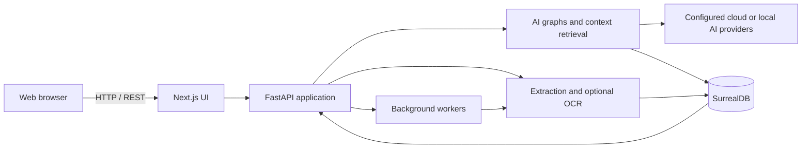
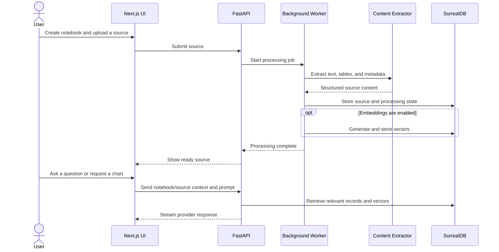

# DocIntel

DocIntel is a private research workspace developed and maintained by Samar Mittal (samarmittal59@gmail.com). It brings documents, notebooks, notes, search, AI conversations, podcasts, and visual explanations into one configurable workspace, with Matplotlib/Python charts and Graphviz DOT diagrams as the default generated formats. Vega-Lite and Mermaid remain available as explicit regeneration options. DocIntel is designed for private, provider-flexible knowledge work and can run as a containerized deployment on a local machine or trusted server.

## What DocIntel can do

- Create notebooks and attach documents, URLs, text, audio, video, and other supported sources.
- Search across notebook content and source material.
- Ask questions in notebook chat or chat with an individual source.
- Generate notes, summaries, insights, transformations, and podcasts.
- Use one or more AI providers/models and configure provider credentials through the UI.
- Generate Vega-Lite charts and Graphviz DOT diagrams directly inside chat.
- Regenerate an existing visualization in Vega-Lite, Graphviz DOT, or Mermaid.
- Download visualizations as PNG or SVG and download their chart or diagram source.
- Keep generated visualization type labels visible in chat.

## Architecture

DocIntel runs as two Docker services:

| Service | Purpose | Default endpoint |
| --- | --- | --- |
| `open_notebook` | Combined Next.js frontend, FastAPI REST API, background worker, and application runtime | Web UI: http://localhost:8502; API: http://localhost:5055 |
| `surrealdb` | Persistent documents, notebooks, sources, notes, credentials metadata, jobs, and vectors | Bound locally to `127.0.0.1:8001` |

The frontend sends requests through FastAPI. Source-processing jobs pass uploaded content, URLs, or media through content extraction and optional embedding, then persist structured results in SurrealDB. Chat and transformation requests select configured language and embedding models, retrieve relevant context, execute in the AI graph layer, and stream results back to the UI.



For a detailed viewer-friendly system diagram, OCR sequence, multilingual flow, and security boundaries, see [ARCHITECTURE.md](ARCHITECTURE.md).

### Main runtime components

| Component | Responsibility |
| --- | --- |
| Next.js frontend | Notebook, source, search, settings, chat, podcast, Markdown, Vega-Lite, Graphviz, Mermaid, and visualization export interfaces |
| FastAPI routers | Authentication, configuration, credentials, sources, notebooks, chat, transformations, search, jobs, and visualization APIs |
| AI graphs | Notebook chat, source chat, transformations, questions, embeddings, and visualization specialist routing |
| Provider registry and model manager | Provider credential resolution and selection of chat, embedding, speech-to-text, and text-to-speech models |
| Content extraction layer | Text-native and scanned-document extraction, URL processing, media processing, OCR, formulas, and optional image/vision analysis |
| Worker/runtime | Background source processing, embeddings, transformations, and podcast tasks |
| SurrealDB | Application records, processing state, credentials metadata, files metadata, and persisted vector data |
| Persistent volume | Uploaded files and runtime state under `notebook_data/`; SurrealDB storage under `surreal_data/` |

### Request flow

1. A user creates a notebook or adds a source in the Next.js UI.
2. FastAPI validates the request and starts source processing through the application worker.
3. Text is extracted according to the selected document or URL engine.
4. Optional embeddings are generated by a configured embedding model.
5. Extracted text, metadata, and vectors are stored in SurrealDB; original uploads remain under the configured persistent data directory.
6. Chat requests retrieve notebook or source context, call the selected provider/model, and stream the response to the UI.
7. Vega-Lite, Graphviz DOT, and optional Mermaid output are handled as specialized Markdown blocks with format labels, regeneration, source download, copy, PNG, and SVG controls.

### Processing lifecycle



### Security boundaries

- The UI and API run together in the application container, while SurrealDB is isolated as its own service.
- Provider credentials are encrypted using `OPEN_NOTEBOOK_ENCRYPTION_KEY` and should never be committed.
- Files and application runtime state are stored in the persistent `notebook_data/` directory.
- Database records and vectors remain in `surreal_data/` for this Docker deployment.
- Mermaid rendering uses strict security mode; generated SVG output is sanitized before insertion into the page.
- Matplotlib execution is limited by code and SVG size limits, execution timeout, import restrictions, AST validation, and temporary working directories.
- Python plot execution is process-restricted rather than a fully isolated untrusted-code sandbox; public deployments should use a stronger isolated execution service.

For the complete component diagram, OCR sequence, multilingual flow, and runtime relationships, see [ARCHITECTURE.md](ARCHITECTURE.md).

## Prerequisites

- Docker Engine and Docker Compose v2.
- At least 4 GB of available memory recommended.
- Internet access for model-provider calls and first-time image/dependency downloads.
- An AI provider account/API key only for cloud models. Providers such as Ollama can be configured locally.

## Quick start

### 1. Prepare configuration

```bash
cp .env.example .env
```

Generate a strong encryption key:

```bash
openssl rand -hex 32
```

Set the generated value in `.env`:

```dotenv
OPEN_NOTEBOOK_ENCRYPTION_KEY=<generated-key>
```

Keep this key private and stable. It encrypts provider credentials stored in DocIntel. Changing it can make previously stored credentials unreadable.

### 2. Build and start DocIntel

```bash
docker compose up -d --build
```

The first build installs frontend and backend dependencies. Subsequent starts reuse the local `docintel:local` image unless source files change and you rebuild it.

### 3. Check startup

```bash
docker compose ps
docker compose logs -f open_notebook
```

Wait until the application container reports healthy, then open:

- Web interface: http://localhost:8502
- REST API: http://localhost:5055
- API configuration check: http://localhost:5055/api/config

### 4. Configure an AI provider

Open `Settings -> Models` in the web interface and add a provider credential. Provider credentials are stored encrypted rather than committed to this repository. Select suitable chat and embedding models for your preferred provider.

Embedding models are required for semantic search and source retrieval features. If they are not configured, note-taking/chat may still work, but embedding-dependent search and document retrieval may be unavailable or incomplete.

## Configuration

Most configuration is performed through `.env` and the Settings interface.

Important `.env` values:

```dotenv
OPEN_NOTEBOOK_ENCRYPTION_KEY=<required>
SURREAL_USER=root
SURREAL_PASSWORD=root
SURREAL_NAMESPACE=open_notebook
SURREAL_DATABASE=open_notebook
```

The default database credentials are intended for local development only. Change both SurrealDB credentials before exposing DocIntel beyond a trusted machine.

Optional settings in `.env.example` include password protection, outbound proxies, upload limits, worker concurrency, remote content engines, and provider API-key fallbacks. Preferred provider setup is through the UI because credentials are then stored by the application's encrypted credential system.

## Using DocIntel

1. Create a notebook.
2. Add sources such as PDFs, URLs, text, or supported media.
3. Wait for source processing to finish.
4. Create notes or insights where needed.
5. Open notebook chat for workspace-wide context or source chat for one document.
6. Select the desired chat and embedding models in Settings.

## Multilingual interface and content

DocIntel has two distinct language-handling layers:

- **Interface localization:** The Next.js frontend ships 14 translated locales, including English, Bengali, Catalan, German, Spanish, French, Italian, Japanese, Polish, Portuguese, Russian, Turkish, and Simplified/Traditional Chinese. The browser language is detected automatically and stored in local storage; English is the fallback when a locale or translation key is unavailable.
- **Generated content and source language:** Provider models and language-aware settings determine the language used for summaries, chat, transformations, transcripts, and podcasts. The backend exposes language selection data from the installed CLDR/Babel and pycountry data rather than maintaining a separate handwritten language list.

YouTube processing also supports preferred transcript languages. Its default preference covers English and major supported regional languages; administrators can update the preferred language list in Settings.

OCR is separate from interface translation. It extracts text from scanned PDFs, images, and documents whose image pixels do not contain a selectable text layer. OCR quality depends on document quality, the selected extraction engine, language/script coverage in the OCR runtime, and model availability. For non-Latin text or mixed-language documents, test sample files and adjust the source language settings provided by the installed extraction stack.

## OCR and document processing

Document extraction supports three document-engine modes under **Settings -> Content Processing**:

| Mode | Behavior |
| --- | --- |
| `auto` | Selects an available extraction path based on the source type; this is the recommended default |
| `docling` | Uses the Docling extraction stack for structured document parsing and optional OCR |
| `simple` | Uses a lighter extraction path and is suitable when advanced document layout analysis is unnecessary |

Enable the optional Docling runtime before starting the application:

```dotenv
OPEN_NOTEBOOK_ENABLE_DOCLING=true
```

The Docker entrypoint installs the Docling runtime and OCR dependencies on first startup. This is a large download, and extraction may take longer after enabling it. Settings also expose:

- **OCR enabled:** Runs OCR for scanned PDFs and images handled by Docling.
- **Extract formulas:** Produces structured mathematical formula markup where supported.
- **Vision processing:** Uses a configured vision model to describe images and charts where supported. This can be slower and may incur provider costs.

Recommended processing flow for multilingual scans:

1. Enable Docling and OCR.
2. Upload a representative sample containing the target language and layout.
3. Select `auto` first; switch to `docling` when layout, tables, scanned pages, formulas, or images need stronger extraction.
4. Review extracted text and embeddings before relying on chat or search.
5. Keep source language preferences explicit where transcript or provider settings require them.

OCR is an extraction aid, not a language guarantee: scripts, handwriting, low-resolution scans, decorative fonts, columns, tables, stamps, and watermarks can reduce accuracy.

## Visualization formats

Generated data charts default to Matplotlib/Python. Relationships, workflows, and architecture diagrams default to Graphviz DOT. Vega-Lite and Mermaid remain available explicitly through each visualization's **Regenerate** menu.

Example:

- “Create a Vega-Lite chart from these quarterly values.”
- “Create a Graphviz DOT architecture diagram for source ingestion, retrieval, and response generation.”
- “Regenerate this visualization as Mermaid.”

Rendered cards show the format in a persistent label. Supported downloads are PNG, SVG, source code, and clipboard copy where the selected visualization format supports that operation.

## Mermaid regeneration

Use requests such as:

- “Create a flowchart showing document upload, extraction, embedding, and search.”
- “Draw a sequence diagram for authentication and API validation.”
- “Create a class diagram for notebooks, sources, notes, and insights.”

Mermaid generation is only requested explicitly or through the regeneration option. The frontend renders Mermaid as SVG and provides PNG, SVG, `.mmd` source download, source copy, and format-regeneration controls.

## Matplotlib charts

Use requests such as:

- “Create a line chart for quarterly values 88.9, 86.3, 92.6, and 92.3.”
- “Generate a bar chart comparing Q1, Q2, Q3, and Q4.”
- “Plot this data as a histogram.”

Python/Matplotlib generation is enabled as the default chart format. The backend executes chart code in a temporary directory and returns SVG output.

TikZ or PGFPlots code pasted with a request such as “Convert and render this chart” is also routed through the Matplotlib specialist so it can be displayed without requiring TikZ compilation in the browser.

The rendered chart provides controls for downloading SVG, downloading `.py` source, and copying source.

## Plot execution and security

The minimal plot implementation applies several safeguards:

- Python code is limited to 20,000 characters.
- Execution uses a 15-second timeout.
- Generated SVG output is limited to 5 MB.
- The AST validator restricts imports to Matplotlib, NumPy, and pandas.
- File access, dynamic Python execution, private attributes, and network-oriented imports are blocked.
- Execution runs with a temporary working directory and temporary Matplotlib configuration.
- Mermaid uses its strict rendering security mode.
- Generated SVG markup is sanitized in the frontend before insertion.

Despite these limits, this is not a sandbox that makes arbitrary untrusted Python safe. It is intended for local/trusted chat use. For deployment where public users submit prompts or code, place Python execution behind a stronger container sandbox or dedicated isolated service.

## Docker operations

```bash
# Validate Compose configuration
docker compose config

# Build and start all services
docker compose up -d --build

# Start existing services
docker compose up -d

# Show service health and ports
docker compose ps

# Follow application logs
docker compose logs -f open_notebook

# Restart the application without rebuilding
docker compose restart open_notebook

# Stop services while retaining data volumes/directories
docker compose down

# Stop and remove containers
docker compose down --remove-orphans
```

Run `docker compose down` only when you want DocIntel stopped. Do not remove or format `notebook_data` or `surreal_data` unless you intend to discard the stored application data.

## Persistent data

| Path | Contents |
| --- | --- |
| `notebook_data/` | Sources, uploads, processing cache, and application data used in `/app/data`. |
| `surreal_data/` | SurrealDB database files. |
| `.env` | Local secrets and configuration; never commit this file. |

Do not commit databases, uploads, API keys, passwords, encryption keys, user notebooks, or generated runtime files to GitHub or GitLab.

## Development

Run frontend checks from the frontend directory:

```bash
cd frontend
npm install
npm test
npm run build
npm run lint
```

Run backend visualization tests from the project root:

```bash
.venv/bin/python -m pytest tests/test_visualization_agents.py tests/test_python_plot.py -q
```

Build the complete Docker image after backend or frontend source changes:

```bash
docker compose up -d --build
```

## GitHub and GitLab publishing checklist

Before the first push:

1. Confirm `.env` is ignored and contains no real secrets.
2. Remove local databases, uploads, API keys, credentials, and generated caches.
3. Review changed files with `git status` and `git diff`.
4. Run frontend tests/build and backend visualization tests.
5. Run `docker compose config`.
6. Verify `LICENSE` and `NOTICE.md` remain included.
7. Do not copy upstream branding, logos, or documentation without reviewing their license and attribution.

## Provider support

Provider support varies by deployment and provider capabilities. Configure language, embedding, speech, and transformation models in the application under `Settings -> Models`.

Supported setup options include OpenAI-compatible endpoints, OpenRouter, Anthropic, Google, Groq, Ollama, Azure/OpenAI-compatible services, and other providers exposed by DocIntel's provider configuration. Confirm available providers in the running application's provider settings.

## Project ownership

DocIntel is developed and maintained by **Samar Mittal**.

- Email: samarmittal59@gmail.com

## Third-party notice and license

MIT-licensed third-party components and their copyright notices are preserved in [LICENSE](LICENSE), with distribution attribution in [NOTICE.md](NOTICE.md). This preserves the rights required by those licenses without changing ownership of Samar Mittal's original DocIntel branding, configuration, and integrations.

## Research paper documentation

A complete IEEE conference-format LaTeX manuscript covering DocIntel's architecture, document-processing pipeline, security model, deployment, provider configuration, evaluation, reproducibility protocol, limitations, and appendices is available in [docs/DocIntel_research_paper.tex](docs/DocIntel_research_paper.tex).

The manuscript describes completed implementation and extraction tests; its OCR and retrieval claims should be refreshed only after controlled ground-truth experiments are run.

The companion system diagrams are in [ARCHITECTURE.md](ARCHITECTURE.md). The LaTeX source can be compiled with an IEEE-compatible LaTeX distribution such as TeX Live or MiKTeX.
